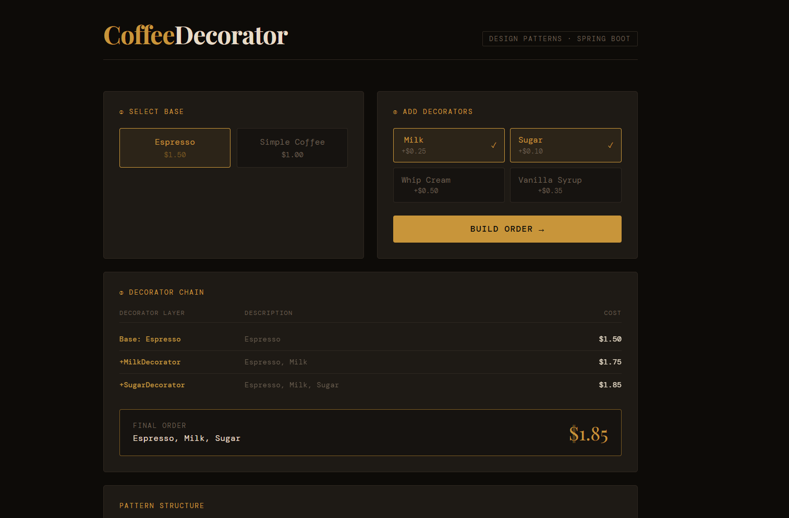

# Decorator Design Pattern — Coffee Orders

The `Coffee` component interface is wrapped by `MilkDecorator`,
`SugarDecorator`, `VanillaDecorator`, and `WhipCreamDecorator`.
Each decorator adds a description and a cost without creating subclasses for
every possible combination.

The order response includes `decoratorChain`, so you can see how layers
are composed and which price each layer produces.

## Run

Requires Java 17 and Maven.

```bash
mvn spring-boot:run
mvn test
```

```bash
curl -X POST http://localhost:8080/api/coffee/order \
  -H 'Content-Type: application/json' \
  -d '{"baseType":"espresso","addons":["milk","vanilla"]}'
```

Supported bases: `espresso`, `simple`. Add-ons: `milk`, `sugar`,
`whip`, `vanilla`. Add-ons are applied in order (duplicates are allowed).
Omitting `addons` produces a plain coffee; invalid or null items return
HTTP 400 instead of silently changing the order.

This is a teaching simulation; it uses `double` for displayed prices.
Production payment amounts should instead use integer minor units or
`BigDecimal`.


